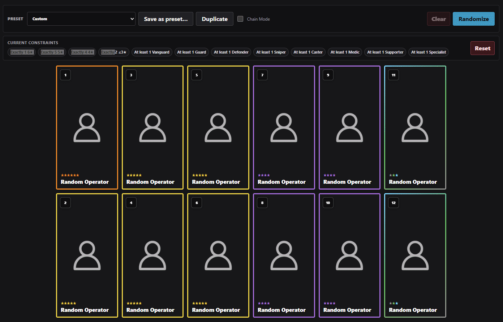
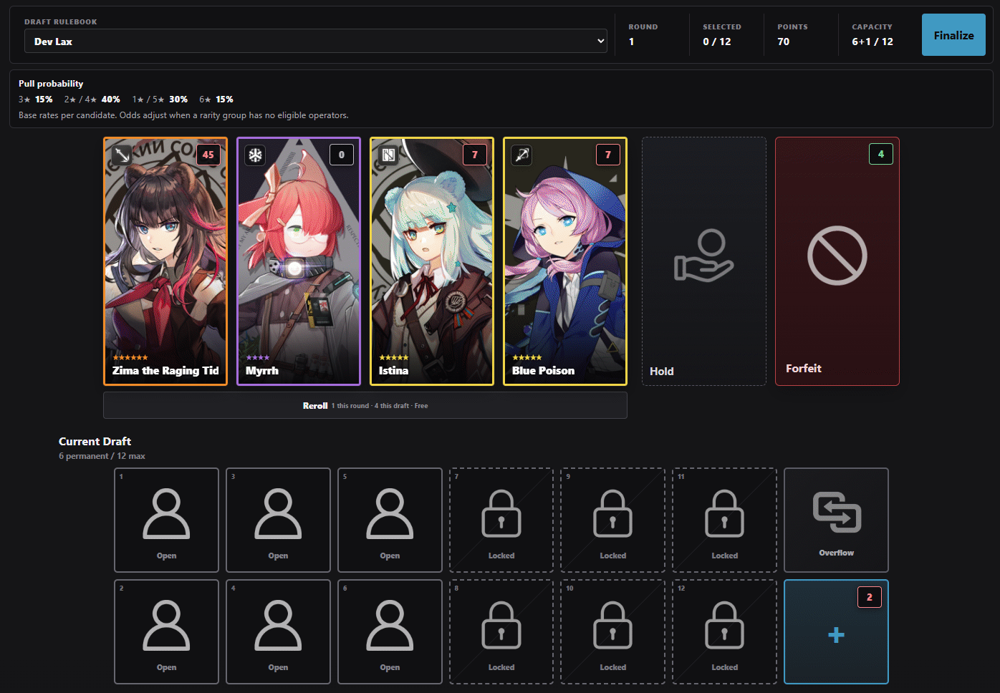
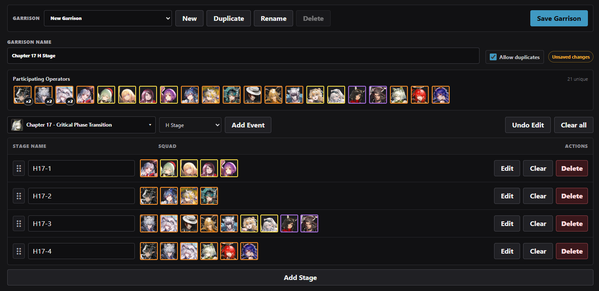
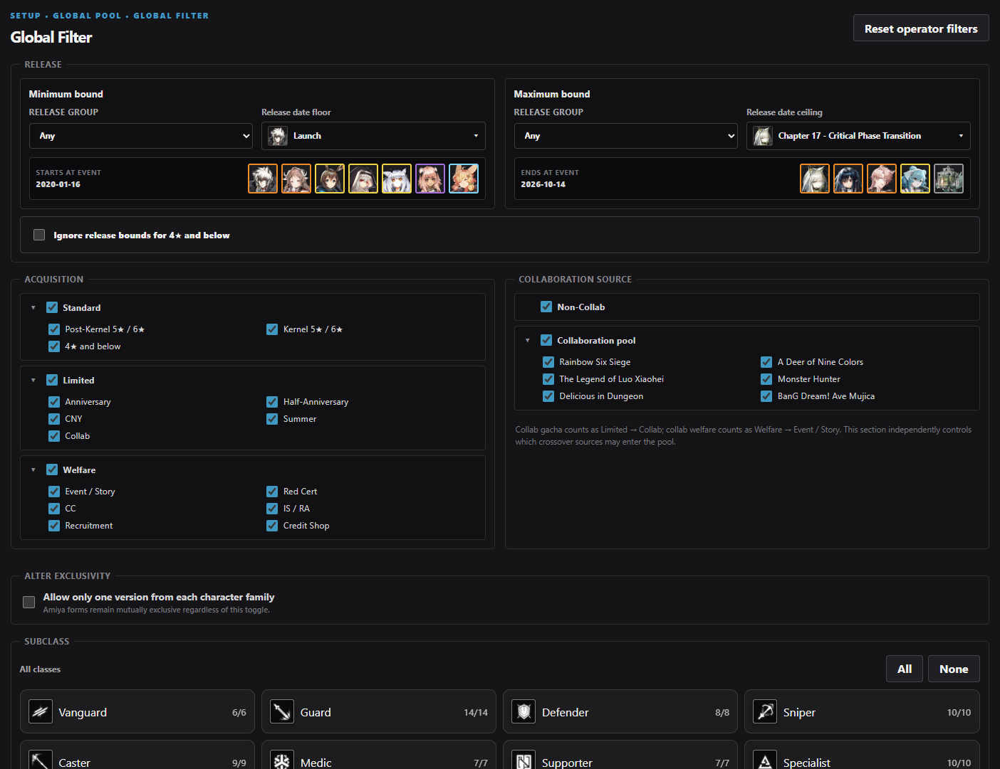
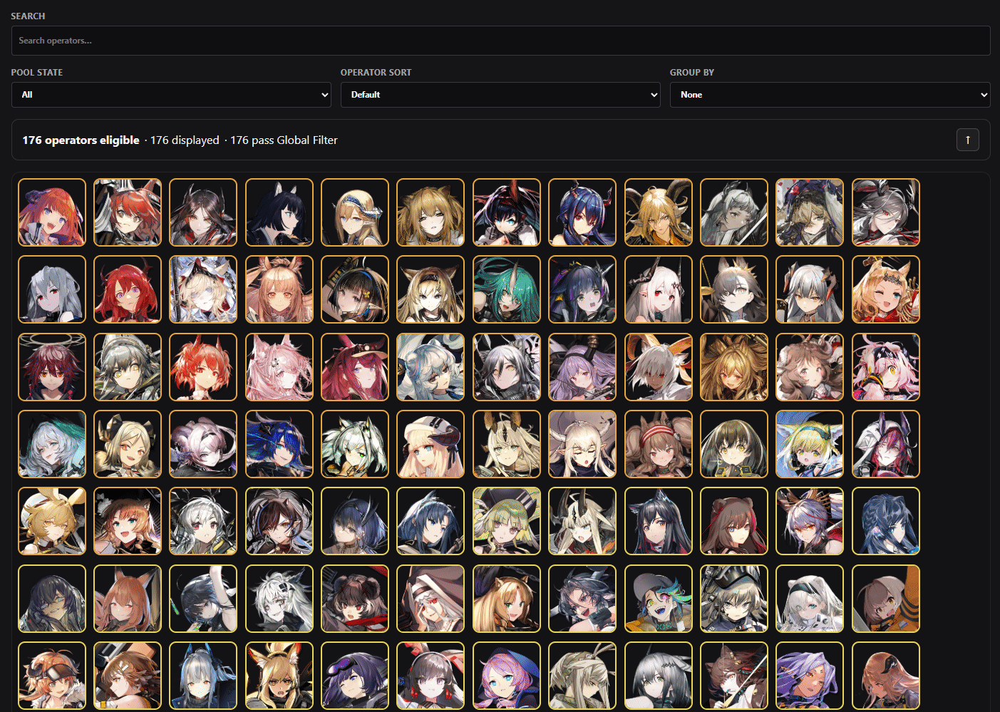

# Arknights Randomizer

Build randomized Arknights squads, play pick-by-pick drafts, or plan separate squads for an entire event. Use the full operator pool, set your own eligibility rules, or sync your roster in the Windows app.

[Play in your browser](https://ak-random.github.io/) · [Download for Windows (x64)](https://github.com/AK-RANDOM/zoot-randomizer-arknights/releases/latest)

The top-right summary shows the app version, operator count, data date, and whether the data is bundled or updated. In v1.2.1, the version appears as **App v1.2.1**.

## Squad modes

### Standard

Generate a squad in one roll. Set the squad size, limit how many operators of each class or rarity can appear, and constrain individual slots. Use a built-in preset or save your own setup for repeat runs.

Use **Keep** to protect individual operators while rerolling other slots, or **Keep All** to mark the entire squad. In **Chain Mode**, operators you reroll out are exhausted for the rest of the chain. Open **Exhausted operators** to see who is out and how many are still available.



### Draft

Build a squad one pick at a time. Start with **Simple Draft** for a pick of one from three offers or **Simple Weighted** for four offers with weighted rarity odds. Other built-in rulebooks can change the operator pool, offer distribution, point costs, capacity, and available actions such as rerolling or holding an offer. Review finished runs in Draft history.



### Garrison

Plan and save squads across multiple stages. Add custom stages or load stages from an event, then build a squad for each stage. Enable cross-stage duplicate prevention when you want each operator assigned to only one squad.



## Customize your operator pool

Use **Setup → Global Pool** to define which operators can appear in Standard and in drafts that use the Global Pool.

- **Global Filter** narrows eligibility by server and release window, acquisition source, collaboration, class or subclass, race, faction, and more. You can also enforce Alter exclusivity.
- **Curate** lets you include or exclude individual operators. Search and group operators to find the ones you want.

Choose EN / Global or CN metadata for availability and release order. Game-data localization controls operator names and terminology separately. The app interface is in English.




## Windows features

The portable Windows app can run offline with bundled operator data and cached artwork. In the app, you can check for operator and event data updates and choose operator artwork in bulk or per operator.

Sync your Arknights account to filter the pool by operator ownership and progression, and use your equipped outfits for operator cards.

In **Options → Data & Storage**, download or resume the full offline artwork cache, open its folder, or clear downloaded artwork.

## Stack

- Electron
- React
- TypeScript
- Vite via electron-vite
- Vitest
- electron-builder

## Development

Prerequisite: **Node.js 24** and npm.

From a clean clone:

```sh
npm ci
npm run data:update
npm run dev
```

Useful validation commands:

```sh
npm run data:validate
npm run typecheck
npm run lint
npm run format:check
npm test
npm run build
```

### Local builds

Compile the Electron application without packaging:

```sh
npm run build
```

Create an unpacked/raw Electron build:

```sh
npm run build:unpack
```

Create the portable Windows release executable:

```sh
npm run build:win
```

`build:unpack` and `build:win` refresh bundled operator metadata before packaging. `build:portable` remains an alias for the portable Windows build.

### Preview and deployment

Use `dev` for review. GitHub Actions publishes a Windows portable prerelease
from `dev`. Promote the reviewed changes to `main` only
after the project owner's explicit approval. A push to `main` publishes the stable Windows release.

For a local web preview, build from `dev` with `npm run build:web`, then run
`npm run preview:web -- --host 127.0.0.1` and open the printed URL.

The [root Pages repository](https://github.com/AK-RANDOM/ak-random.github.io) deploys the production site from the app repository’s `main` branch. For each approved release, dispatch its Pages workflow and verify that the [live source revision](https://ak-random.github.io/source-revision.txt) matches the released commit.

```sh
gh workflow run pages.yml --repo AK-RANDOM/ak-random.github.io --ref main
```

## Data and artwork

The project consumes public Arknights community/game-data sources and normalizes them into its own application schema. Update scripts live in `scripts/`.

Generated operator metadata and class icons under `resources/bundled-data` are intentionally not part of the public source snapshot; they are recreated with `npm run data:update` for development and packaging.

Operator avatars and promotion artwork are not packaged with the public application source. They are downloaded into the persistent user-data artwork cache as needed so an installed copy can continue using cached artwork offline. Missing artwork falls back gracefully instead of making squad generation unavailable.

Current upstream sources include:

- operator data: `ArknightsAssets/ArknightsGamedata`
- operator imagery: `yuanyan3060/ArknightsGameResource`
- class/branch icons: `tohmatosauce/ak-branch-icons`
- operator release metadata: `nadering/arknights-toolbox`

Arknights and its game assets are property of their respective rights holders. This project is an unofficial fan utility. Third-party game data and artwork are not represented as project-owned material.

See `THIRD_PARTY_NOTICES.md` for source-by-source provenance and licensing notes.

## Windows releases

Windows releases are distributed as a single portable executable. Portable update data is kept in `Arknights-Randomizer-Data` beside the executable when writable.

Current builds are unsigned, so Windows may display its normal warning for unsigned applications.

## Automation

CI validates pull requests.

## Workboard and documentation

GitHub **Issues** are the active project workboard and source of truth for implementation tasks. `WORKBOARD.md` is only a pointer and is not a second workboard.

Useful project documentation:

- `docs/ARCHITECTURE.md` — application architecture baseline;
- `docs/ITERATION6_DATA.md` — operator-data and filtering model;
- repository Issues — current implementation and Draft design work.

## License

The original Arknights Randomizer source code is licensed under the MIT License; see `LICENSE`.

The MIT grant does **not** apply to Arknights game data, artwork, names, trademarks, or other third-party material consumed or generated by this project. Those materials remain subject to their respective rights holders and upstream terms; see `THIRD_PARTY_NOTICES.md`.
